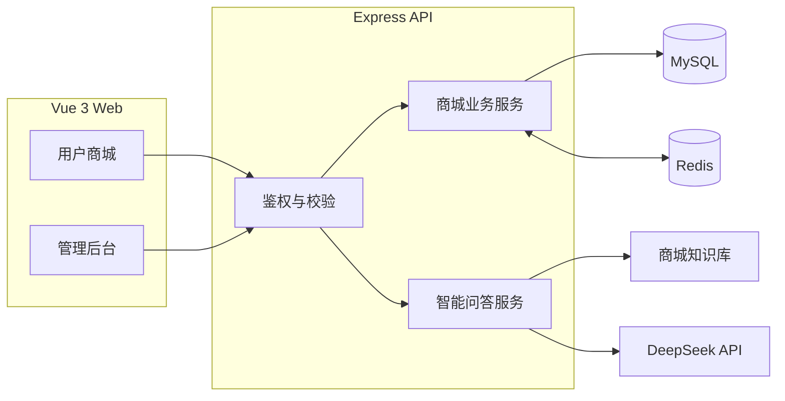

<div align="center">

# 盲盒星球商城系统

基于 Vue 3、Express、MySQL 与 Redis 的全栈商城项目，包含用户商城、运营后台、智能问答与自动化测试工程。

[](https://github.com/xiaoli50823/new_shop/actions/workflows/ci.yml)

</div>

## 项目概览

盲盒星球覆盖盲盒浏览、抽取、购物车、订单、盒柜、积分商城、优惠券和签到等业务，并提供商品、订单、用户、奖品、分类、营收和缓存管理后台。

项目重点不只在功能实现，也包含可复用的测试基础设施：接口自动化、UI 自动化、SQL 落库校验、Redis 缓存专项测试，以及提交代码后自动执行的 GitHub Actions 回归流程。

| 模块 | 实现内容 |
| --- | --- |
| 用户端 | 首页、发现、搜索、盲盒详情、购物车、订单、盒柜、积分与优惠券 |
| 管理端 | 数据大盘、盲盒、奖品、分类、订单、用户、营收、系统与缓存管理 |
| 服务端 | JWT 鉴权、角色权限、事务、抽盒算法、WebSocket、参数校验与限流 |
| 数据层 | MySQL 持久化、Sequelize ORM、Redis 商品缓存 |
| 智能问答 | 基于商城知识库与在售商品的轻量级 RAG，支持多轮上下文 |
| 质量保障 | Pytest、Requests、Playwright、SQL 校验、Node Test、Allure、GitHub Actions |

## 技术栈

| 前端 | 后端 | 数据与测试 |
| --- | --- | --- |
| Vue 3、TypeScript、Vite | Express、JWT、Socket.io | MySQL、Redis |
| Pinia、Vue Router | Sequelize、express-validator | Pytest、Requests、Playwright、Allure |
| Element Plus、Tailwind CSS | bcryptjs、multer | GitHub Actions、Node Test |

## 系统架构



## 核心设计

### 接口自动化

- 使用 Pytest Fixture 统一管理客户端、普通用户与管理员鉴权。
- 使用 YAML 管理登录等参数化数据，公共断言统一校验 HTTP 状态和业务码。
- 覆盖登录、购物车、订单和缓存管理等核心接口。
- 订单创建后通过 SQL 校验数据库记录，并在用例结束前取消订单以减少脏数据。

### UI 自动化

- 使用 Playwright 回归公开首页、鉴权跳转和登录成功后的核心流程。
- Chromium 以无头模式运行，适用于本地与 CI 环境。
- GitHub Actions 自动启动前后端后执行 UI 回归。

### Redis 缓存专项

- 缓存命中：重复查询验证 `X-Cache: HIT`。
- 写后失效：商品数据变更后提升版本号，使旧缓存立即失效。
- 并发加载：同一资源的并发请求合并回源，降低数据库压力。
- 故障回源：Redis 不可用时快速降级到 MySQL，不阻断核心查询。

### 持续集成

`.github/workflows/ci.yml` 在提交或拉取请求时执行两阶段验证：

1. 安装锁定依赖，运行后端测试、前端生产构建并校验 Pytest 用例收集。
2. 启动 MySQL、Redis、Express 和 Vite，执行接口与 UI 自动化回归。
3. 生成 Allure HTML 报告并作为 Actions 构建产物保留。
4. 回归失败时上传前后端日志，便于定位问题。

## 快速开始

### 环境要求

- Node.js 20 或更高版本
- Python 3.10 或更高版本
- MySQL 5.7 或更高版本
- Redis 6 或更高版本，可选

### 1. 创建数据库

```sql
CREATE DATABASE blind_box_shop
  DEFAULT CHARACTER SET utf8mb4
  COLLATE utf8mb4_unicode_ci;
```

### 2. 配置服务端

```bash
cp server/.env.example server/.env
```

至少配置数据库密码与 JWT 密钥。Redis 和 DeepSeek 均为可选能力，完整变量说明见 [`server/.env.example`](./server/.env.example)。

### 3. 安装依赖并初始化数据

```bash
npm run install:all
npm run seed --prefix server
```

### 4. 启动项目

分别打开两个终端：

```bash
npm run dev --prefix server
```

```bash
npm run dev --prefix client
```

访问地址：

- 用户端：`http://localhost:3000`
- 管理端：`http://localhost:3000/admin`
- API 健康检查：`http://localhost:8080/api/health`

本地种子账号仅用于开发：

| 角色 | 邮箱 | 密码 |
| --- | --- | --- |
| 管理员 | `admin@blindbox.com` | `admin123` |
| 普通用户 | `user@blindbox.com` | `user123` |

## 运行验证

### 前端构建与后端测试

```bash
npm test
```

### 接口自动化

先启动后端并初始化数据库，然后执行：

```bash
cd automation
python -m pip install -r requirements.txt
python -m pytest tests_api
```

### UI 自动化与 Allure 结果

```bash
cd automation
python -m playwright install chromium
python -m pytest tests_ui --alluredir=allure-results --clean-alluredir
```

完整说明见 [`automation/README.md`](./automation/README.md)。

## 项目结构

```text
new_shop/
├── .github/workflows/ci.yml   # 自动构建与完整回归
├── client/                    # Vue 3 用户端与管理端
├── server/                    # Express API、MySQL、Redis 与 Node 测试
├── automation/                # Pytest、Requests、Playwright 与 SQL 校验
├── API接口文档.md             # API 契约与示例
├── Redis与智能问答设计.md     # 缓存与智能问答设计
└── README.md
```

## 相关文档

- [API 接口文档](./API接口文档.md)
- [Redis 与智能问答设计](./Redis与智能问答设计.md)
- [自动化测试工程说明](./automation/README.md)

## 许可证

本项目基于 [MIT License](./LICENSE) 开源。
